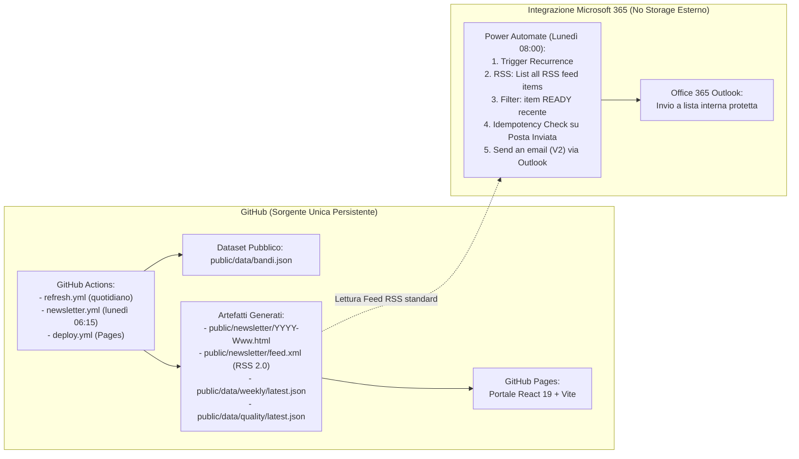

# Osservatorio Bandi Reggio Emilia — RE Funding Intelligence
## Edizione GitHub-only + Power Automate + Outlook (SENZA SharePoint e SENZA OneDrive)

Piattaforma avanzata di **Funding Intelligence** e monitoraggio strategico dei bandi europei, nazionali e regionali per il **Comune di Reggio Emilia** (Mandato 2024-2029).

Il sistema monitora costantemente le opportunità allineate alle **6 linee strategiche del DUP** e ai progetti comunali prioritari, pubblicando un portale interattivo su GitHub Pages ed emettendo automaticamente ogni lunedì mattina un bollettino informativo email-safe inviato tramite Microsoft Power Automate & Office 365 Outlook.

---

## 1. Architettura di Sistema



### Vincoli Rispettati
- **Nessuna dipendenza da SharePoint o OneDrive:** Nessun file archiviato in cartelle cloud personali o di team.
- **Nessun connettore HTTP Premium:** Utilizzo del connettore standard **RSS** (*List all RSS feed items*) di Power Automate.
- **Nessun servizio SMTP esterno né Mailchimp:** Invio nativo tramite **Office 365 Outlook** (*Send an email V2*).
- **Riservatezza assoluta:** Nessun indirizzo email né dato personale memorizzato nel repository pubblico.
- **Core senza IA generativa:** Punteggio e classificazione deterministici; modulo Copilot M365 chiaramente disabilitato fino ad approvazione formale.

---

## 2. Tabella di Migrazione dei Dati (122 Record Conservati)

Tutti i **122 bandi originali** estratti dall'archivio `Osservatorio Bandi Reggio Emilia.zip` sono stati migrati senza perdite né alterazioni nei contenuti, garantendo il pieno roundtrip:

| Campo Legacy | Tipo Legacy | Campo Canonico 2.0 | Tipo & Regole Canoniche |
|---|---|---|---|
| `titolo` | string | `original.titolo` & `evidenceLinks[].title` | Preservato verbatim; validazione stringa non vuota |
| `ente` | string | `original.ente` & `validity.verificationSource` | Normalizzato e impiegato nell'hash ID univoco |
| `programma` | string | `original.programma` | Preservato verbatim |
| `categoria` | string | `original.categoria` & `sourceType` | Mappato in enum: `ue`, `nazionale_pnrr`, `regione_er`, `fondazioni` |
| `linee` | string[] | `original.linee` & `strategicLines` | Validato su set `['L1','L2','L3','L4','L5','L6']` |
| `descrizione` | string | `original.descrizione` & `publicSummary` | Testo divulgativo pubblico |
| `beneficiari` | string | `original.beneficiari` & `eligibility` | Mappato in: `confirmed` (Comuni/ATS), `potential`, `excluded` |
| `dotazione` | string | `original.dotazione` | Preservato verbatim |
| `contributo_max`| string | `original.contributo_max` | Preservato verbatim |
| `cofinanziamento`| string | `original.cofinanziamento` & `risks[]` | Preservato e analizzato per avvisi di bilancio |
| `scadenza` | string | `deadline` | `YYYY-MM-DD` o `null` se a sportello |
| `scadenza_tipo` | string | `deadlineType` | Enum: `data`, `sportello`, `in_definizione`, `prorogato` |
| `url` | string | `sourceCanonicalUrl` & `sourceDomain` | Validazione formato URL HTTP/HTTPS |
| `note` | string | `sourceEvidence` & `changeLog[].note` | Evidenze istruttorie e storico verifiche |
| *Nuovo* | - | `id` | Hash deterministico SHA-256 (`re-bando-[hash]`) con collision handling |
| *Nuovo* | - | `state` | Enum: `open`, `rolling_verified`, `closed`, `unknown`, `suspended` |
| *Nuovo* | - | `score0to100` | Valutazione motivata da 0 a 100 per priorità PA |
| *Nuovo* | - | `scoreReasons[]` | Elenco esplicito delle motivazioni del punteggio |
| *Nuovo* | - | `thematicTags[]` | Tag semantici per matching automatico progetti |

---

## 3. Guida Operativa Power Automate

La guida completa con le espressioni Power Automate è disponibile in [docs/POWER_AUTOMATE_SETUP.md](docs/POWER_AUTOMATE_SETUP.md).

### Sintesi Parametri
- **Trigger**: Recurrence settimanale (Ogni Lunedì alle ore 08:00, fuso `W. Europe Standard Time`, *Concurrency Control = 1*).
- **Azione RSS**: Standard *List all RSS feed items* con URL `https://<OWNER>.github.io/<REPO>/newsletter/feed.xml`.
- **Filtro Matrice**:
  ```text
  @and(
    equals(item()?['category'], 'READY_LATEST'),
    greaterOrEquals(item()?['publishDate'], addDays(utcNow(), -3))
  )
  ```
- **Controllo Idempotenza**: *Get emails (V3)* su cartella Posta Inviata con query sull'ID edizione `RE-FUNDING-YYYY-Www`. Se già inviata, il flusso si arresta con successo senza duplicare l'invio.
- **Invio Email**: *Send an email (V2)* con oggetto `[RE Funding] Opportunita della settimana - RE-FUNDING-YYYY-Www` e corpo HTML preso dal campo `summary`.

---

## 4. Installazione, Build e Test Locali

### Requisiti
- Node.js >= 20.x
- npm >= 10.x

### Comandi Disponibili
```bash
# 1. Installa le dipendenze
npm install

# 2. Esegui la migrazione dal dataset originale legacy
npm run migrate

# 3. Esegui la verifica Quality Gate (Fail Closed)
npm run verify-quality

# 4. Genera la newsletter e il feed RSS per la settimana
npm run generate-newsletter

# 5. Esegui l'intera suite di test automatizzati (vitest)
npm test

# 6. Typecheck TypeScript
npx tsc --noEmit

# 7. Compila l'applicazione per produzione (Vite)
npm run build

# 8. Avvia il server di sviluppo
npm run dev
```

---

## 5. Progetti Strategici Comunali (`projects.json`)

Il portale include la sezione **Matching Progetti RE**, collegata a `projects.json`, che monitora 7 interventi cardine dell'Amministrazione:
1. **Osservatorio Urbano** (Linee L1, L4, L6)
2. **RE_ACTS** (Transizione ecologica e resilienza urbana - Linee L3, L5)
3. **Digital Twin** (Smart mobility e modellazione 3D - Linee L2, L3, L4)
4. **Smart City** (Servizi digitali e IoT nei quartieri - Linee L1, L4, L5)
5. **Data Governance** (Interoperabilità PDND e dati aperti - Linea L4)
6. **Innovazione Amministrativa** (Competenze, assunzioni sociali LEPS - Linea L4)
7. **Rigenerazione Urbana** (Patrimonio, spazi culturali, aree verdi - Linee L1, L3, L5, L6)

Tutti i progetti operano con flag `"mode": "example"` in attesa di validazione formale dei quadri economici.

---

## 6. Riservatezza e Trasparenza Giuridica

- **Protezione dei dati personali:** In conformità al GDPR e alle policy di trasparenza, nessun nominativo, indirizzo email o metadato privato è memorizzato nel repository. La lista di distribuzione risiede unicamente all'interno della tenancy Microsoft 365 del Comune.
- **Valore indicativo delle informazioni:** Le schede informative e i punteggi attribuiti costituiscono supporto all'intelligence strategica e non sostituiscono l'esame della documentazione ufficiale. I funzionari sono tenuti a verificare requisiti, modulistica e scadenze sui canali istituzionali dell'ente erogatore prima di inoltrare candidature.
