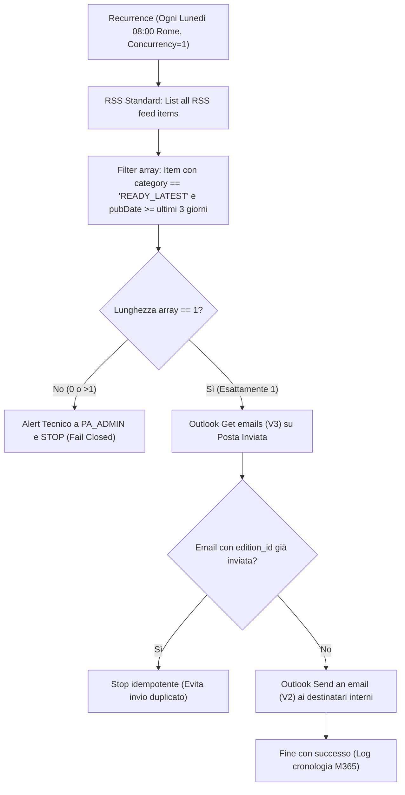

# GUIDA OPERATIVA POWER AUTOMATE — RE FUNDING INTELLIGENCE
## Flusso Cloud Schedulato Lunedì ore 08:00 (Senza SharePoint, Senza OneDrive, Senza HTTP Premium)

Questa guida illustra la configurazione dettagliata passo-passo del flusso Microsoft Power Automate per l'invio automatizzato della newsletter settimanale delle opportunità di finanziamento.

---

### Architettura del Flusso



---

### Parametri e Variabili da Personalizzare

| Parametro | Descrizione | Dove si imposta | Valore Esempio |
|---|---|---|---|
| `FEED_URL` | URL pubblico del feed RSS 2.0 | Nel connettore RSS | `https://osservatorio-urbano.github.io/osservatorio-bandi-re/newsletter/feed.xml` |
| `PA_TIMEZONE` | Fuso orario schedulazione | Nel trigger Recurrence | `(UTC+01:00) Amsterdam, Berlin, Bern, Rome, Stockholm, Vienna` |
| `PA_TO` | Destinatari interni autorizzati | Azione *Send an email (V2)* | `dirigenti-comune@comune.re.it; taskforce-bandi@comune.re.it` |
| `PA_ADMIN` | Casella tecnica per allarmi | Azione invio alert su errore | `supporto-sistemi-informativi@comune.re.it` |

---

### Procedura Passo-Passo nel Portale Power Automate

#### Passo 1: Creazione Flusso e Configurazione Trigger Recurrence
1. Accedi a [make.powerautomate.com](https://make.powerautomate.com) con l'utenza di servizio dell'Ente.
2. Clicca su **Crea** > **Flusso cloud pianificato**.
3. Denomina il flusso: `RE Funding - Newsletter Lunedì - AUTOMATICA`.
4. Configura i parametri:
   - **Inizia il**: primo lunedì utile alle `08:00:00`.
   - **Ripeti ogni**: `1` **Settimana**.
   - **In questi giorni**: `Lunedì`.
   - **Fuso orario**: `(UTC+01:00) Amsterdam, Berlin, Bern, Rome, Stockholm, Vienna` (`W. Europe Standard Time`).
5. **Critico**: Apri le **Impostazioni** del blocco trigger Recurrence:
   - Attiva **Controllo concorrenza** (*Concurrency Control*).
   - Imposta **Grado di parallelismo** = `1` (garantisce un'unica istanza in esecuzione ed evita race condition).

#### Passo 2: Azione RSS Standard "List all RSS feed items"
1. Clicca su **Nuovo passaggio** e cerca `RSS`.
2. Seleziona l'azione standard **List all RSS feed items** (Nessun costo premium, nessun HTTP connector).
3. Inserisci il campo:
   - **RSS feed URL**: `https://osservatorio-urbano.github.io/osservatorio-bandi-re/newsletter/feed.xml`

#### Passo 3: Filtro dell'Edizione della Settimana Corrente
1. Aggiungi l'azione **Operazione dati** > **Filter array** (Filtra matrice).
2. Nel campo **Da**: seleziona l'output `body` dell'azione RSS precedente.
3. Configura la condizione di filtraggio in modalità avanzata:
   ```text
   @and(
     equals(item()?['category'], 'READY_LATEST'),
     greaterOrEquals(item()?['publishDate'], addDays(utcNow(), -3))
   )
   ```
   *Nota:* Questo filtro seleziona esclusivamente l'edizione validata come pronta nelle ultime 72 ore, impedendo il recupero di edizioni obsolete.

#### Passo 4: Verifica di Unicità e Quality Gate (Fail Closed)
1. Aggiungi un'azione **Condizione** per verificare la presenza di esattamente un item:
   ```text
   length(body('Filter_array'))
   uguale a
   1
   ```
2. Nel ramo **Se falso (No)**:
   - Aggiungi un'azione **Office 365 Outlook > Send an email (V2)** verso `PA_ADMIN`.
   - Oggetto: `[ALERT TECNICO] Anomalia generazione newsletter RE Funding`.
   - Corpo: `Il controllo di qualità ha rilevato 0 o più di 1 edizione READY nel feed RSS. L'invio automatico è stato interrotto per salvaguardare l'integrità dei dati.`
   - Aggiungi l'azione **Termina** con stato `Failed`.

#### Passo 5: Controllo Idempotenza su Posta Inviata (Prevenzione Doppio Invio)
1. Nel ramo **Se vero (Sì)**:
   - Assegna l'oggetto dell'edizione a una variabile o usa direttamente l'espressione:
     `first(body('Filter_array'))?['title']` (es. `RE-FUNDING-2026-W44`).
2. Aggiungi l'azione **Office 365 Outlook > Get emails (V3)**:
   - **Cartella**: `Sent Items` (o `Posta inviata` a seconda della localizzazione della cassetta postale).
   - **Query di ricerca**: `first(body('Filter_array'))?['title']`
   - **Top**: `10`
3. Aggiungi una **Condizione**:
   ```text
   length(body('Get_emails_(V3)')?['value'])
   maggiore di
   0
   ```
4. Se maggiore di 0:
   - L'email per l'edizione corrente è già stata spedita (es. rilancio manuale o esecuzione precedente).
   - Aggiungi l'azione **Termina** con stato `Succeeded` (stop idempotente senza invio duplicato).

#### Passo 6: Invio Newsletter tramite Outlook
1. Nel ramo **Se falso** della verifica duplicati (email non ancora inviata):
2. Aggiungi l'azione **Office 365 Outlook > Send an email (V2)**:
   - **A (To)**: `PA_TO` (es. elenco dirigenti o casella istituzionale concordata, MAI esposta su GitHub).
   - **Oggetto (Subject)**: `[RE Funding] Opportunita della settimana - @{first(body('Filter_array'))?['title']}`
   - **Corpo (Body)**: seleziona il campo dinamico `summary` (oppure `description`) restituito dall'azione RSS per l'item filtrato:
     `@{first(body('Filter_array'))?['summary']}`
   - Apri le opzioni avanzate:
     - **Is HTML**: `Sì`
     - **Importance**: `Normale`

#### Passo 7: Gestione Errori e Ripristino Controllato
- Microsoft non restituisce un Message-ID persistente sull'azione *Send an email (V2)*. In caso di timeout o stato incerto:
  - **NON eseguire cicli di retry automatici non presidiati.**
  - Verificare prima la presenza dell'email nella cartella *Posta inviata* della casella mittente.
  - Se assente, rilanciare manualmente il flusso dal portale Power Automate (il controllo sull'oggetto univoco `RE-FUNDING-YYYY-Www` garantisce che non verranno effettuate spedizioni doppie).
